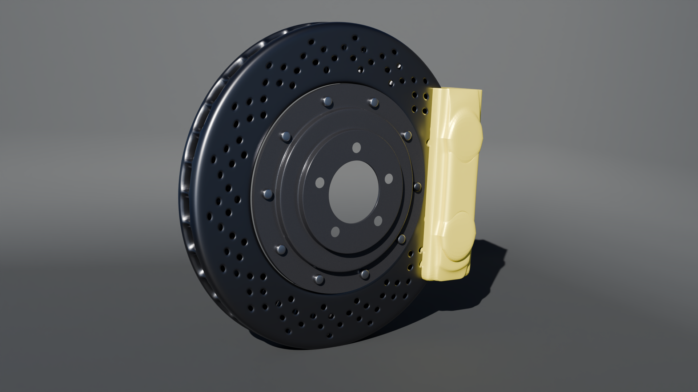

# Ferrari F40 — Brake Disc & Caliper

A 3D modelling and visualization project featuring a Ferrari F40-inspired brake disc and caliper, created using Blender 5.2.1 LTS.

## Final Render

## Project Overview

This project focuses on creating a detailed automotive brake assembly, with an emphasis on hard-surface modelling, mechanical detailing, materials, and realistic rendering.

## Model Details

- Drilled brake rotor
- Ventilated disc design
- Central mounting hub
- Mounting bolts and hardware
- Brake caliper
- Metallic materials and studio lighting

## Software

- Blender 5.2.1 LTS

## Project Files

| File | Description |
|---|---|
| `F40_Disk_Brake.blend` | Blender project file |
| `F40_Disk_Brake.png` | Final render |

## About

An independent 3D modelling project created to develop automotive hard-surface modelling, mechanical detailing, and product visualization skills.

**Project Status:** Completed

*This is a visualisation model, not a functional brake-component design.*
